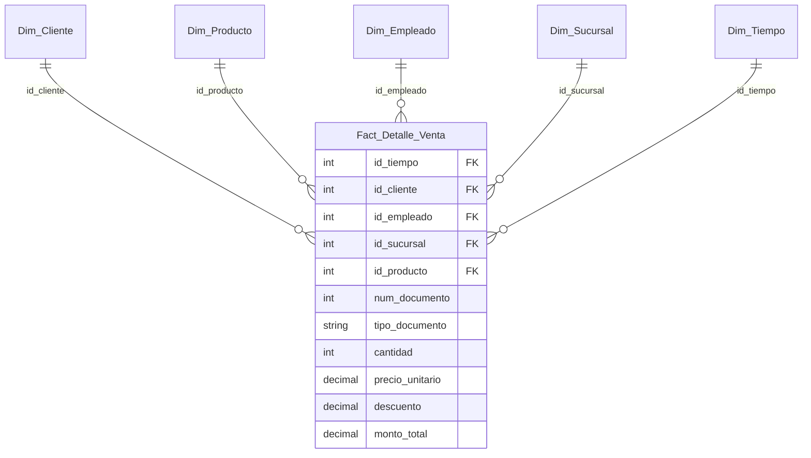

# Certamen 2 - Inteligencia de Negocios

Universidad Técnica Federico Santa María · Año académico 2026

## Caso seleccionado

**Caso 1: Mueblería Albarrán**

## Integrantes y sección

| Integrante | Usuario GitHub |
|---|---|
| Gabriel Molina | `GabrielMolinaUsm135` |
| Macarena Mogollón | `makimogollon` |
| Lukas Cordova | `lukascordova` |
| Daniel Garcia | `<COMPLETAR>` |

- **Sección:** 300
- **Profesor:** Hernán Saavedra

## Descripción del problema

Mueblería Albarrán es una empresa innovadora del rubro de la mueblería que ha crecido rápidamente en los últimos años. Sus datos operativos se almacenan en una base de datos transaccional relacional que registra sucursales (y sus comunas), clientes, empleados (y sus cargos), productos (y sus categorías) y ventas con su detalle. Sin embargo, la empresa no dispone de una solución de Inteligencia de Negocios optimizada para analítica, lo que dificulta consolidar información histórica y apoyar de forma oportuna las decisiones estratégicas del propietario.

## Objetivo del proyecto

Desarrollar una solución de Inteligencia de Negocios que apoye al dueño de la empresa en su toma de decisiones. El proyecto se construye en dos fases:

- **Fase 1:** diseño e implementación del modelo dimensional (Data Warehouse) y del proceso ETL con SSIS.

## KPI definidos

| KPI | Fórmula | Justificación |
|---|---|---|
| **Total de Ventas Netas ($)** | `Σ (cantidad × precio_unitario − descuento)` | Mide los ingresos reales tras descuentos; es la base para evaluar la salud financiera del negocio. |
| **Volumen de Unidades Vendidas** | `Σ cantidad` | Permite identificar rotación de stock, demanda por categoría y volumen físico por sucursal. |
| **Ticket Promedio por Venta ($)** | `Total Ventas Netas / N° de transacciones` (`SUM(monto_total) / COUNT(DISTINCT num_documento)`) | Cuantifica el gasto medio por transacción y permite evaluar efectividad comercial y comportamiento de compra. |
| **Descuento Promedio Otorgado (%)** | `Σ descuento / Σ (cantidad × precio_unitario) × 100` | Controla el margen cedido en promociones y estrategias comerciales. |

> Todos los KPI pueden segmentarse por tiempo, sucursal/comuna, producto/categoría, vendedor/cargo y perfil de cliente.

## Modelo dimensional

Esquema en **estrella** basado en la metodología de Ralph Kimball.

### Proceso de negocio

**Ventas y facturación de muebles y productos en las sucursales** de la empresa.

### Granularidad

Un registro por **cada línea de producto dentro de un documento de venta** (equivale a una fila de `detalle_ventas`, identificada por `venta_id` + `producto_id`). Este nivel atómico permite análisis tanto agregados como detallados.

### Dimensiones

Cada dimensión usa una **clave subrogada** entera como PK y conserva la clave de origen (*business key*) para el mapeo en el ETL.

| Dimensión | Atributos |
|---|---|
| **Dim_Cliente** | `id_cliente` (PK), `cliente_id_origen`, `nombre`, `apellido_paterno`, `apellido_materno`, `nombre_completo` (derivado), `sexo`, `fecha_nacimiento`, `estado_civil` |
| **Dim_Producto** | `id_producto` (PK), `producto_id_origen`, `nombre_producto`, `descripcion`, `precio_referencial`, `categoria` (desnormalizado desde `categorias`) |
| **Dim_Empleado** | `id_empleado` (PK), `empleado_id_origen`, `nombre`, `apellido_paterno`, `apellido_materno`, `nombre_cargo` (desnormalizado desde `cargos`), `fecha_contrato`, `sueldo_base` |
| **Dim_Sucursal** | `id_sucursal` (PK), `sucursal_id_origen`, `sucursal`, `comuna` (desnormalizado desde `comunas`) |
| **Dim_Tiempo** | `id_tiempo` (PK, entero `YYYYMMDD`), `fecha`, `anio`, `mes`, `nombre_mes`, `dia`, `dia_semana`, `trimestre` |

### Tabla de hechos y medidas

**Fact_Detalle_Venta**

- **Claves foráneas:** `id_tiempo`, `id_cliente`, `id_empleado`, `id_sucursal`, `id_producto`.
- **Dimensiones degeneradas:** `num_documento`, `tipo_documento`.
- **Medidas aditivas:**
  - `cantidad`: unidades vendidas.
  - `precio_unitario`: precio facturado por ítem.
  - `descuento`: rebaja aplicada al ítem.
  - `monto_total`: `cantidad × precio_unitario − descuento`.

### Resumen de los 4 pasos de Kimball

| Paso | Decisión |
|---|---|
| 1. Proceso de negocio | Ventas y facturación en sucursales |
| 2. Granularidad | Una línea de producto por documento de venta |
| 3. Dimensiones | Cliente, Producto, Empleado, Sucursal, Tiempo |
| 4. Medidas y tabla de hechos | `Fact_Detalle_Venta` con cantidad, precio_unitario, descuento y monto_total |

### Diagrama



Imagen del diagrama: `docs/modelo-dimensional/` *(COMPLETAR con el archivo exportado)*.

## Proceso ETL - Fase 1

Implementado en **Visual Studio con SSIS**, desde la base transaccional hacia el modelo dimensional en SQL Server.

**Flujo general:** carga de dimensiones (`Dim_Tiempo`, `Dim_Cliente`, `Dim_Producto`, `Dim_Empleado`, `Dim_Sucursal`) y luego de `Fact_Detalle_Venta`, para respetar las claves foráneas.

**Transformaciones y calidad de datos:**

- **Validación de consistencia:** se evitan nulos o valores inconsistentes en `descuento`, `cantidad` y `precio_unitario`.
- **Estandarización de texto:** eliminación de espacios sobrantes y unificación de mayúsculas/minúsculas en categorías, cargos, comunas y nombres.
- **Sustitución de nulos:** valores por defecto (por ejemplo, `"Sin Información"` en apellido materno) para mantener la integridad referencial.
- **Desnormalización:** categoría, cargo y comuna se integran en sus dimensiones (producto, empleado, sucursal).
- **Atributo derivado:** `nombre_completo` en `Dim_Cliente`; `monto_total` en la tabla de hechos.
- **Claves subrogadas:** *Lookup* de la clave de origen hacia la clave subrogada al cargar la tabla de hechos.
- **Registros rechazados:** *COMPLETAR (por ejemplo, tabla o archivo de errores).*

**Paquetes SSIS:** *COMPLETAR lista de paquetes (por ejemplo, `CargaDimCliente.dtsx`, `CargaFactDetalleVenta.dtsx`, ...).*

**Validación de la carga:**

```sql
-- Total de la boleta de ejemplo
SELECT num_documento, SUM(monto_total) AS Total_Final_Boleta
FROM Fact_Detalle_Venta
WHERE num_documento = 1050
GROUP BY num_documento;

-- Cuadratura de filas origen vs. destino (ajustar nombres de BD)
SELECT (SELECT COUNT(*) FROM <BD_ORIGEN>.dbo.detalle_ventas) AS filas_origen,
       (SELECT COUNT(*) FROM <BD_DW>.dbo.Fact_Detalle_Venta) AS filas_destino;

-- Cuadratura de monto total
SELECT SUM(cantidad * precio_unitario - descuento) AS monto_origen
FROM <BD_ORIGEN>.dbo.detalle_ventas;
SELECT SUM(monto_total) AS monto_destino
FROM <BD_DW>.dbo.Fact_Detalle_Venta;
```

*COMPLETAR con los resultados obtenidos (capturas en `docs/`).*


## Distribución de responsabilidades y aportes

| Integrante | Responsabilidades y principales aportes |
|---|---|
| Gabriel Molina | *COMPLETAR* |
| Macarena Mogollón | *COMPLETAR* |
| Lukas Cordova | *COMPLETAR* |
| Daniel Garcia | *COMPLETAR* |

