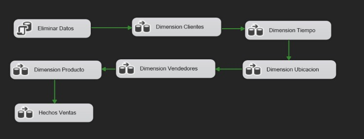

# Certamen 2 - Inteligencia de Negocios

**Universidad Técnica Federico Santa María · Año académico 2026**

## Caso seleccionado

**Caso 1: Mueblería Albarrán**

| Dato | Detalle |
|---|---|
| Sección | 300 |
| Profesor | Hernán Saavedra |

## Integrantes

| Integrante | Usuario GitHub |
|---|---|
| Gabriel Molina | [GabrielMolinaUsm135](https://github.com/GabrielMolinaUsm135) |
| Macarena Mogollón | [makimogollon](https://github.com/makimogollon) |
| Lukas Cordova | [lukascordova](https://github.com/lukascordova) |
| Daniel González | [GonzalezDanielRojas](https://github.com/GonzalezDanielRojas) |

# ---------------------- FASE 1 ---------------------- 

## 1. Descripción del problema

La Mueblería Albarrán almacena en una base de datos relacional información de sucursales y comunas, clientes, empleados y cargos, productos y categorías, ventas y detalle de ventas. El proyecto propone una solución de Inteligencia de Negocios que consolide estos datos para analizar el desempeño de las ventas y apoyar las decisiones del propietario.

## 2. Objetivo y alcance

Desarrollar una solución de Inteligencia de Negocios para analizar las ventas de la empresa.

- **Fase 1:** diseñar e implementar el Data Warehouse dimensional y el proceso ETL con SQL Server y SSIS.
- **Fase 2:** el repositorio incluye el proyecto SSAS y el archivo `powerbi/dashboard.pbix`. Este README describe los KPI y análisis previstos.

## 3. KPI definidos

| KPI | Fórmula | Utilidad |
|---|---|---|
| **Total de ventas netas ($)** | `SUM(MontoTotalVenta)`, donde `MontoTotalVenta = CantidadProducto × PrecioUnitarioProducto − DescuentoProducto` | Mide los ingresos después de aplicar descuentos. |
| **Unidades vendidas** | `SUM(CantidadProducto)` | Permite analizar volumen y demanda por producto, categoría y sucursal. |
| **Ticket promedio por venta ($)** | `SUM(MontoTotalVenta) / COUNT(DISTINCT VentaID_BK)` | Mide el monto neto medio por transacción. |
| **Descuento promedio otorgado (%)** | `SUM(DescuentoProducto) / SUM(CantidadProducto × PrecioUnitarioProducto) × 100` | Mide la proporción descontada respecto del monto bruto vendido. |

Los KPI se pueden analizar por fecha, sucursal y comuna, producto y categoría, empleado y cargo, y cliente.

Los datos transaccionales permiten calcular los KPI porque contienen el encabezado y detalle de ventas, con fecha, producto, cantidad, precio y descuento, además de las entidades que permiten segmentar por cliente, empleado y sucursal. En la transformación se consideran posibles valores nulos, fechas faltantes, relaciones a categoría/cargo/comuna no encontradas y espacios sobrantes. La ejecución de las validaciones de origen y destino se documenta en la sección **Validación de la carga**.

## 4. Modelo dimensional

Se utiliza un esquema estrella siguiendo los cuatro pasos de Kimball:

| Paso | Decisión |
|---|---|
| Proceso de negocio | Ventas y facturación de productos en las sucursales. |
| Granularidad | Una fila por línea de detalle de una venta. |
| Dimensiones | Cliente, producto, empleado, sucursal y tiempo. |
| Medidas y tabla de hechos | `FactVentas`: cantidad, precio unitario, descuento y monto neto. |

### Dimensiones

Las dimensiones de cliente, producto, empleado y sucursal tienen una clave subrogada `IDENTITY` y conservan la clave de negocio de origen (`*_BK`). La dimensión de tiempo utiliza como clave primaria la fecha en formato entero `YYYYMMDD`.

| Tabla | Atributos |
|---|---|
| `DimCliente` | `ClienteSK`, `ClienteID_BK`, `NombreCompletoCliente`, `NombreSexo`, `EstadoCivilCliente`, `FechaNacimientoCliente` |
| `DimProducto` | `ProductoSK`, `ProductoID_BK`, `NombreProducto`, `NombreCategoria`, `PrecioUnitarioReferencial` |
| `DimEmpleado` | `EmpleadoSK`, `EmpleadoID_BK`, `NombreCompletoEmpleado`, `NombreCargo`, `FechaContratoEmpleado` |
| `DimSucursal` | `SucursalSK`, `SucursalID_BK`, `NombreSucursal`, `NombreComuna` |
| `DimTiempo` | `TiempoSK`, `Fecha`, `Anio`, `Trimestre`, `NumeroMes`, `NombreMes`, `NumeroDia`, `NombreDiaSemana` |

### Tabla de hechos

`FactVentas` almacena una fila por línea de venta. Sus claves foráneas son `ProductoSK`, `ClienteSK`, `EmpleadoSK`, `SucursalSK` y `TiempoSK`. `NumeroDocumento` y `TipoDocumento` se conservan como dimensiones degeneradas.

| Medida | Descripción |
|---|---|
| `CantidadProducto` | Unidades incluidas en la línea. |
| `PrecioUnitarioProducto` | Precio unitario registrado en la venta. |
| `DescuentoProducto` | Descuento aplicado a la línea. |
| `MontoTotalVenta` | Monto neto de la línea: cantidad por precio unitario menos descuento. |

`PrecioUnitarioProducto` es una medida no aditiva: no se debe sumar para obtener un total de ventas.

### Diagrama Modelo Dimensional (Estrella)


### Script de creación del DW
-- 1. Crear o reiniciar la base de datos del Data Warehouse
DROP DATABASE IF EXISTS DW_Albarran;
GO

CREATE DATABASE DW_Albarran;
GO

USE DW_Albarran;
GO

-- 2. Crear Dimensi�n Cliente
CREATE TABLE DimCliente (
    ClienteSK INT IDENTITY(1,1) PRIMARY KEY,
    ClienteID_BK INT NOT NULL,
    NombreCompletoCliente VARCHAR(150),
    NombreSexo VARCHAR(50),
    EstadoCivilCliente VARCHAR(100),
    FechaNacimientoCliente DATE
);
GO

-- 3. Crear Dimensi�n Empleado
CREATE TABLE DimEmpleado (
    EmpleadoSK INT IDENTITY(1,1) PRIMARY KEY,
    EmpleadoID_BK INT NOT NULL,
    NombreCompletoEmpleado VARCHAR(150),
    NombreCargo VARCHAR(100),
    FechaContratoEmpleado DATE
);
GO

-- 4. Crear Dimensi�n Sucursal
CREATE TABLE DimSucursal (
    SucursalSK INT IDENTITY(1,1) PRIMARY KEY,
    SucursalID_BK INT NOT NULL,
    NombreSucursal VARCHAR(100),
    NombreComuna VARCHAR(100)
);
GO

-- 5. Crear Dimensi�n Producto
CREATE TABLE DimProducto (
    ProductoSK INT IDENTITY(1,1) PRIMARY KEY,
    ProductoID_BK INT NOT NULL,
    NombreProducto VARCHAR(150),
    NombreCategoria VARCHAR(100),
    PrecioUnitarioReferencial DECIMAL(18,2)
);
GO

-- 6. Crear Dimensi�n Tiempo (Con IDENTITY y NumeroTrimestre)
CREATE TABLE DimTiempo (
    TiempoSK INT IDENTITY(1,1) PRIMARY KEY,
    Fecha DATE NOT NULL,
    Anio INT,
    NumeroTrimestre INT,
    NumeroMes INT,
    NombreMes VARCHAR(50),
    NumeroDia INT
);
GO

-- 7. Crear Tabla de Hechos (FactVentas)
CREATE TABLE FactVentas (
    VentaSK INT IDENTITY(1,1) PRIMARY KEY,
    VentaID_BK INT NOT NULL,
    ProductoSK INT FOREIGN KEY REFERENCES DimProducto(ProductoSK),
    ClienteSK INT FOREIGN KEY REFERENCES DimCliente(ClienteSK),
    EmpleadoSK INT FOREIGN KEY REFERENCES DimEmpleado(EmpleadoSK),
    SucursalSK INT FOREIGN KEY REFERENCES DimSucursal(SucursalSK),
    TiempoSK INT FOREIGN KEY REFERENCES DimTiempo(TiempoSK),
    NumeroDocumento VARCHAR(50),
    TipoDocumento VARCHAR(50),
    CantidadProducto INT,
    PrecioUnitarioProducto DECIMAL(18,2),
    DescuentoProducto DECIMAL(18,2),
    MontoTotalVenta DECIMAL(18,2)
);
GO

### Script de insercción de datos al DW
USE DW_Albarran;
GO

-- 1. Limpieza previa en orden inverso por las Foreign Keys
DELETE FROM FactVentas;
DELETE FROM DimTiempo;
DELETE FROM DimCliente;
DELETE FROM DimEmpleado;
DELETE FROM DimSucursal;
DELETE FROM DimProducto;

-- 2. Cargar DimCliente
-- 2. Cargar DimCliente (Transformando M -> Masculino y F -> Femenino)
INSERT INTO DimCliente (ClienteID_BK, NombreCompletoCliente, NombreSexo, EstadoCivilCliente, FechaNacimientoCliente)
SELECT DISTINCT 
    c.cliente_id, 
    LTRIM(RTRIM(c.nombre)) + ' ' + 
    ISNULL(LTRIM(RTRIM(c.appaterno)), '') + ' ' + 
    ISNULL(LTRIM(RTRIM(c.apmaterno)), ''),
    CASE UPPER(LTRIM(RTRIM(c.sexo)))
        WHEN 'M' THEN 'Masculino'
        WHEN 'F' THEN 'Femenino'
        ELSE 'No especificado'
    END,
    c.estado_civil,
    CAST(c.fecha_nacimiento AS DATE)
FROM MuebleriaAlbarran..clientes c;

-- 3. Cargar DimEmpleado (con alias e. en appatemo y apmatemo)
INSERT INTO DimEmpleado (EmpleadoID_BK, NombreCompletoEmpleado, NombreCargo, FechaContratoEmpleado)
SELECT DISTINCT 
    e.empleado_id, 
    LTRIM(RTRIM(e.nombre)) + ' ' + 
    ISNULL(LTRIM(RTRIM(e.appaterno)), '') + ' ' + 
    ISNULL(LTRIM(RTRIM(e.apmaterno)), ''),
    ISNULL(ca.nombre, 'Sin Cargo'),
    CAST(e.fecha_contrato AS DATE)
FROM MuebleriaAlbarran..empleados e
LEFT JOIN MuebleriaAlbarran..cargos ca ON e.cargo_id = ca.cargo_id;

-- 4. Cargar DimSucursal
INSERT INTO DimSucursal (SucursalID_BK, NombreSucursal, NombreComuna)
SELECT DISTINCT 
    s.sucursal_id, 
    s.sucursal, 
    ISNULL(co.comuna, 'Sin Comuna')
FROM MuebleriaAlbarran..sucursales s
LEFT JOIN MuebleriaAlbarran..comunas co ON s.comuna_id = co.comuna_id;

-- 5. Cargar DimProducto (usando cat.categoria)
INSERT INTO DimProducto (ProductoID_BK, NombreProducto, NombreCategoria, PrecioUnitarioReferencial)
SELECT DISTINCT 
    p.producto_id, 
    p.nombre, 
    ISNULL(cat.categoria, 'General'),
    p.precio
FROM MuebleriaAlbarran..productos p
LEFT JOIN MuebleriaAlbarran..categorias cat ON p.categoria_id = cat.categoria_id;

-- 6. Cargar DimTiempo (usando NumeroTrimestre)
INSERT INTO DimTiempo (Fecha, Anio, NumeroTrimestre, NumeroMes, NombreMes, NumeroDia)
SELECT DISTINCT 
    CAST(v.fecha AS DATE) AS Fecha,
    YEAR(v.fecha) AS Anio,
    CASE 
        WHEN MONTH(v.fecha) BETWEEN 1 AND 3 THEN 1
        WHEN MONTH(v.fecha) BETWEEN 4 AND 6 THEN 2
        WHEN MONTH(v.fecha) BETWEEN 7 AND 9 THEN 3
        WHEN MONTH(v.fecha) BETWEEN 10 AND 12 THEN 4
    END AS NumeroTrimestre,
    MONTH(v.fecha) AS NumeroMes,
    CASE MONTH(v.fecha)
        WHEN 1 THEN 'Enero'
        WHEN 2 THEN 'Febrero'
        WHEN 3 THEN 'Marzo'
        WHEN 4 THEN 'Abril'
        WHEN 5 THEN 'Mayo'
        WHEN 6 THEN 'Junio'
        WHEN 7 THEN 'Julio'
        WHEN 8 THEN 'Agosto'
        WHEN 9 THEN 'Septiembre'
        WHEN 10 THEN 'Octubre'
        WHEN 11 THEN 'Noviembre'
        WHEN 12 THEN 'Diciembre'
    END AS NombreMes,
    DAY(v.fecha) AS NumeroDia
FROM MuebleriaAlbarran..ventas v
WHERE v.fecha IS NOT NULL
ORDER BY CAST(v.fecha AS DATE);

-- 7. Cargar FactVentas
INSERT INTO FactVentas (
    VentaID_BK, ProductoSK, ClienteSK, EmpleadoSK, SucursalSK, TiempoSK, 
    NumeroDocumento, TipoDocumento, CantidadProducto, PrecioUnitarioProducto, DescuentoProducto, MontoTotalVenta
)
SELECT 
    v.venta_id,
    prod.ProductoSK,
    cli.ClienteSK,
    emp.EmpleadoSK,
    suc.SucursalSK,
    t.TiempoSK,
    v.numero_documento,
    v.tipo_documento,
    dv.cantidad,
    dv.precio_unitario,
    ISNULL(dv.descuento, 0),
    (CAST(dv.cantidad AS DECIMAL(18,2)) * CAST(dv.precio_unitario AS DECIMAL(18,2))) - ISNULL(dv.descuento, 0) AS MontoTotalVenta
FROM MuebleriaAlbarran..ventas v
INNER JOIN MuebleriaAlbarran..detalle_ventas dv ON v.venta_id = dv.venta_id
INNER JOIN DimCliente cli ON v.cliente_id = cli.ClienteID_BK
INNER JOIN DimEmpleado emp ON v.vendedor_id = emp.EmpleadoID_BK
INNER JOIN DimSucursal suc ON v.sucursal_id = suc.SucursalID_BK
INNER JOIN DimProducto prod ON dv.producto_id = prod.ProductoID_BK
INNER JOIN DimTiempo t ON CAST(v.fecha AS DATE) = t.Fecha;

### Script de verificación de datos
USE DW_Albarran;
GO

SELECT 
    v.VentaSK,
    v.VentaID_BK,
    t.Fecha,
    t.Anio,
    t.NombreMes,
    s.NombreSucursal,
    s.NombreComuna,
    c.NombreCompletoCliente,
    c.NombreSexo,
    e.NombreCompletoEmpleado,
    e.NombreCargo,
    p.NombreProducto,
    p.NombreCategoria,
    v.CantidadProducto,
    p.PrecioUnitarioReferencial,
    (v.CantidadProducto * p.PrecioUnitarioReferencial) AS MontoTotalCalculado
FROM FactVentas v
LEFT JOIN DimTiempo t ON v.TiempoSK = t.TiempoSK
LEFT JOIN DimSucursal s ON v.SucursalSK = s.SucursalSK
LEFT JOIN DimCliente c ON v.ClienteSK = c.ClienteSK
LEFT JOIN DimEmpleado e ON v.EmpleadoSK = e.EmpleadoSK
LEFT JOIN DimProducto p ON v.ProductoSK = p.ProductoSK;

## 5. Proceso ETL
El proyecto SSIS se encuentra en [`etl/proyecto-ssis/ProyectoMuebleria/`](etl/proyecto-ssis/ProyectoMuebleria/). El paquete extrae datos de la base transaccional `Albarran` y los carga en `DW_Albarran`.

El flujo carga las dimensiones antes de la tabla de hechos para que las claves foráneas estén disponibles. En la carga de hechos se resuelven las claves de negocio hacia las claves subrogadas. La dimensión de tiempo usa la clave `YYYYMMDD`, compartida entre la dimensión y los hechos.

### Diagrama de proceso ETL



### Transformaciones documentadas

- Se eliminan espacios sobrantes al componer nombres de clientes y empleados.
- El sexo del cliente se estandariza (`M` como masculino, `F` como femenino y otros valores como no especificados).
- Categoría, cargo y comuna se integran en las dimensiones de producto, empleado y sucursal.
- Se asignan valores por defecto cuando no se encuentra categoría, cargo o comuna; el descuento nulo se trata como cero.
- El monto neto de cada línea resta el descuento al producto de cantidad por precio unitario.
- Las ventas sin fecha no se incorporan a la dimensión de tiempo.

# ---------------------- FASE 2 ---------------------- 

## 7. Cubo OLAP

El cubo OLAP debe permitir analizar los KPI definidos mediante las dimensiones de tiempo, cliente, producto, empleado y sucursal del Data Warehouse. El proyecto SSAS se debe incluir en `olap/proyecto-ssas/`.


## 8. Dashboard Power BI

El dashboard está destinado al propietario de la mueblería y debe presentar los KPI de ventas netas, unidades vendidas, ticket promedio y descuento promedio, con filtros para analizar los resultados por tiempo, sucursal, producto, vendedor y cliente. El archivo de Power BI se debe incluir en `powerbi/`.


# ---------------------- DOCUMENTACION ---------------------- 

## 1. Tecnologías y estructura del repositorio

**Tecnologías:** SQL Server, Visual Studio con SQL Server Integration Services (SSIS), SQL Server Analysis Services (SSAS), Power BI y GitHub.

```text
database/
  backup/                         Backups de las bases de datos de origen y DW
  scripts/                        Creación y carga SQL del Data Warehouse
docs/                             Caso y pauta del certamen
etl/proyecto-ssis/ProyectoMuebleria/
                                  Solución y paquete ETL de SSIS
modelo_dimensional/               Diagrama estrella
olap/proyecto-ssas/                Ubicación del proyecto SSAS
powerbi/                          Ubicación del archivo Power BI
README.md                         Documentación del proyecto
```

## 2. Instrucciones de ejecución y revisión

1. Restaurar el backup transaccional [`Albarran.bak`](database/backup/Albarran.bak) en SQL Server con el nombre `Albarran`, que es el utilizado por las conexiones y consultas del proyecto.
2. Ejecutar [`01_creacion_dw_albarran.sql`](database/scripts/01_creacion_dw_albarran.sql) para crear el Data Warehouse.
   **Advertencia:** este script elimina y vuelve a crear `DW_Albarran`. Respaldar la base antes de ejecutarlo si se desea conservarla.
3. Para cargar el DW mediante SQL, ejecutar [`02_insercion_de_datos_al_dw.sql`](database/scripts/02_insercion_de_datos_al_dw.sql). Este script limpia las tablas del DW antes de insertar los datos.
4. Para ejecutar el ETL, abrir [`ProyectoMuebleria.sln`](etl/proyecto-ssis/ProyectoMuebleria/ProyectoMuebleria.sln) en Visual Studio con la extensión de proyectos SSIS. Verificar las conexiones de origen `Albarran` y destino `DW_Albarran`, y ejecutar el paquete.
5. Ejecutar las consultas de la sección **Validación de la carga** y guardar los resultados de la comprobación.

# ---------------------- Responsabilidades y los principales aportes de cada  integrante ---------------------- 

1.Gabriel Molina: Construcción de ETL y las consultas de recepción de datos, revisón y edición del archivo README.md.
2.Macarena Mogollón: Construcción del DW y consultas SQL de insercción y verificación de datos. Construcción cubo OLAP mediante SQL Server Analysis Services y sus KPI. Revisón y edición del archivo README.md.
3.Lukas Cordova: Validar la salida de los datos en la aplicación PowerBI.
4.Daniel González: Revisar archivo README.md, verificar los scripts SQL.
