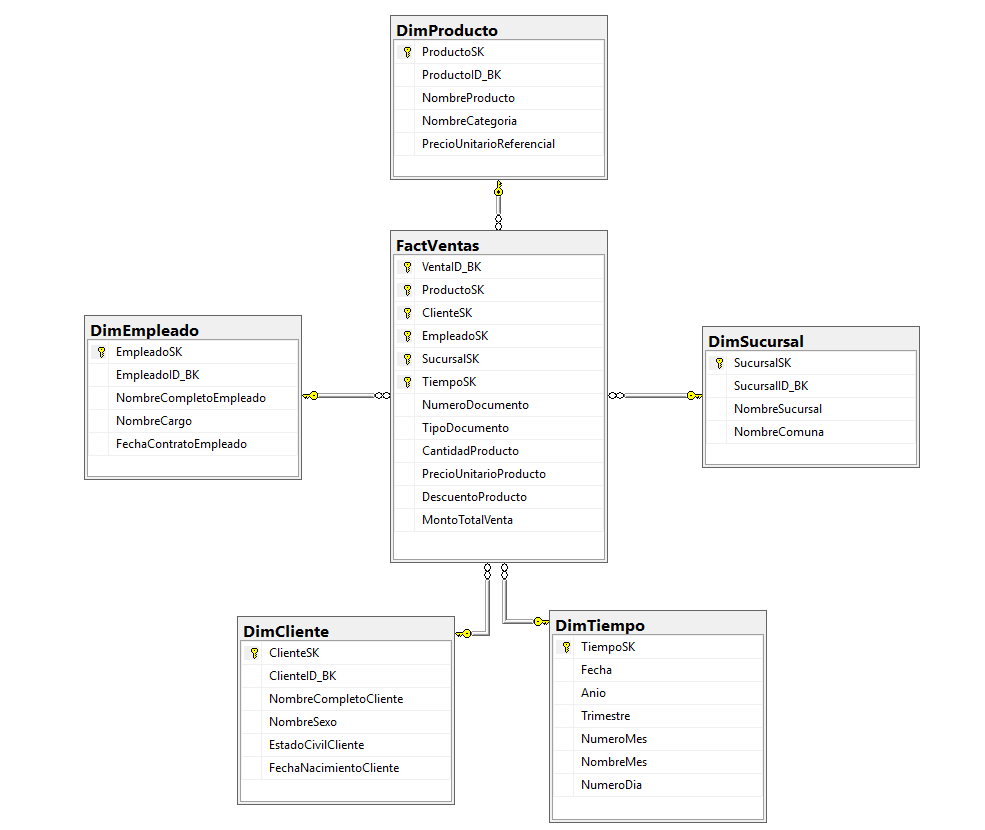

# Certamen 2 - Inteligencia de Negocios

**Universidad Técnica Federico Santa María · Año académico 2026**

## Caso seleccionado

**Caso 1: Mueblería Albarrán**

| Dato | Detalle |
|---|---|
| Sección | 300 |
| Profesor | Hernán Saavedra |

## Integrantes

| Integrante | Usuario GitHub |
|---|---|
| Gabriel Molina | [GabrielMolinaUsm135](https://github.com/GabrielMolinaUsm135) |
| Macarena Mogollón | [makimogollon](https://github.com/makimogollon) |
| Lukas Cordova | [lukascordova](https://github.com/lukascordova) |
| Daniel González | [GonzalezDanielRojas](https://github.com/GonzalezDanielRojas) |

## 1. Descripción del problema

La Mueblería Albarrán almacena en una base de datos relacional información de sucursales y comunas, clientes, empleados y cargos, productos y categorías, ventas y detalle de ventas. El proyecto propone una solución de Inteligencia de Negocios que consolide estos datos para analizar el desempeño de las ventas y apoyar las decisiones del propietario.

## 2. Objetivo y alcance

Desarrollar una solución de Inteligencia de Negocios para analizar las ventas de la empresa.

- **Fase 1:** diseñar e implementar el Data Warehouse dimensional y el proceso ETL con SQL Server y SSIS.
- **Fase 2:** el repositorio incluye el proyecto SSAS y el archivo `powerbi/dashboard.pbix`. Este README describe los KPI y análisis previstos.

## 3. KPI definidos

| KPI | Fórmula | Utilidad |
|---|---|---|
| **Total de ventas netas ($)** | `SUM(MontoTotalVenta)`, donde `MontoTotalVenta = CantidadProducto × PrecioUnitarioProducto − DescuentoProducto` | Mide los ingresos después de aplicar descuentos. |
| **Unidades vendidas** | `SUM(CantidadProducto)` | Permite analizar volumen y demanda por producto, categoría y sucursal. |
| **Ticket promedio por venta ($)** | `SUM(MontoTotalVenta) / COUNT(DISTINCT VentaID_BK)` | Mide el monto neto medio por transacción. |
| **Descuento promedio otorgado (%)** | `SUM(DescuentoProducto) / SUM(CantidadProducto × PrecioUnitarioProducto) × 100` | Mide la proporción descontada respecto del monto bruto vendido. |

Los KPI se pueden analizar por fecha, sucursal y comuna, producto y categoría, empleado y cargo, y cliente.

Los datos transaccionales permiten calcular los KPI porque contienen el encabezado y detalle de ventas, con fecha, producto, cantidad, precio y descuento, además de las entidades que permiten segmentar por cliente, empleado y sucursal. En la transformación se consideran posibles valores nulos, fechas faltantes, relaciones a categoría/cargo/comuna no encontradas y espacios sobrantes. La ejecución de las validaciones de origen y destino se documenta en la sección **Validación de la carga**.

## 4. Modelo dimensional

Se utiliza un esquema estrella siguiendo los cuatro pasos de Kimball:

| Paso | Decisión |
|---|---|
| Proceso de negocio | Ventas y facturación de productos en las sucursales. |
| Granularidad | Una fila por línea de detalle de una venta. |
| Dimensiones | Cliente, producto, empleado, sucursal y tiempo. |
| Medidas y tabla de hechos | `FactVentas`: cantidad, precio unitario, descuento y monto neto. |

### Dimensiones

Las dimensiones de cliente, producto, empleado y sucursal tienen una clave subrogada `IDENTITY` y conservan la clave de negocio de origen (`*_BK`). La dimensión de tiempo utiliza como clave primaria la fecha en formato entero `YYYYMMDD`.

| Tabla | Atributos |
|---|---|
| `DimCliente` | `ClienteSK`, `ClienteID_BK`, `NombreCompletoCliente`, `NombreSexo`, `EstadoCivilCliente`, `FechaNacimientoCliente` |
| `DimProducto` | `ProductoSK`, `ProductoID_BK`, `NombreProducto`, `NombreCategoria`, `PrecioUnitarioReferencial` |
| `DimEmpleado` | `EmpleadoSK`, `EmpleadoID_BK`, `NombreCompletoEmpleado`, `NombreCargo`, `FechaContratoEmpleado` |
| `DimSucursal` | `SucursalSK`, `SucursalID_BK`, `NombreSucursal`, `NombreComuna` |
| `DimTiempo` | `TiempoSK`, `Fecha`, `Anio`, `Trimestre`, `NumeroMes`, `NombreMes`, `NumeroDia`, `NombreDiaSemana` |

### Tabla de hechos

`FactVentas` almacena una fila por línea de venta. Sus claves foráneas son `ProductoSK`, `ClienteSK`, `EmpleadoSK`, `SucursalSK` y `TiempoSK`. `NumeroDocumento` y `TipoDocumento` se conservan como dimensiones degeneradas.

| Medida | Descripción |
|---|---|
| `CantidadProducto` | Unidades incluidas en la línea. |
| `PrecioUnitarioProducto` | Precio unitario registrado en la venta. |
| `DescuentoProducto` | Descuento aplicado a la línea. |
| `MontoTotalVenta` | Monto neto de la línea: cantidad por precio unitario menos descuento. |

`PrecioUnitarioProducto` es una medida no aditiva: no se debe sumar para obtener un total de ventas.

### Diagrama



## 5. Proceso ETL - Fase 1

El proyecto SSIS se encuentra en [`etl/proyecto-ssis/ProyectoMuebleria/`](etl/proyecto-ssis/ProyectoMuebleria/). El paquete extrae datos de la base transaccional `Albarran` y los carga en `DW_Albarran`.

El flujo carga las dimensiones antes de la tabla de hechos para que las claves foráneas estén disponibles. En la carga de hechos se resuelven las claves de negocio hacia las claves subrogadas. La dimensión de tiempo usa la clave `YYYYMMDD`, compartida entre la dimensión y los hechos.

### Transformaciones documentadas

- Se eliminan espacios sobrantes al componer nombres de clientes y empleados.
- El sexo del cliente se estandariza (`M` como masculino, `F` como femenino y otros valores como no especificados).
- Categoría, cargo y comuna se integran en las dimensiones de producto, empleado y sucursal.
- Se asignan valores por defecto cuando no se encuentra categoría, cargo o comuna; el descuento nulo se trata como cero.
- El monto neto de cada línea resta el descuento al producto de cantidad por precio unitario.
- Las ventas sin fecha no se incorporan a la dimensión de tiempo.

## 6. Validación de la carga

Ejecutar estas consultas en SQL Server después de cargar el Data Warehouse. Las filas de origen y destino, y los montos netos, deben coincidir. Si no coinciden, revisar errores o filas no cargadas antes de considerar validado el proceso.

```sql
USE DW_Albarran;
GO

-- Comparar el número de líneas de venta.
SELECT
    (SELECT COUNT(*) FROM Albarran.dbo.detalle_ventas) AS FilasOrigen,
    (SELECT COUNT(*) FROM dbo.FactVentas) AS FilasDestino;

-- Comparar el monto neto de origen y destino.
SELECT
    (SELECT SUM(dv.cantidad * dv.precio_unitario - ISNULL(dv.descuento, 0))
     FROM Albarran.dbo.detalle_ventas AS dv) AS MontoNetoOrigen,
    (SELECT SUM(MontoTotalVenta)
     FROM dbo.FactVentas) AS MontoNetoDestino;

-- Revisar el total neto de un documento de ejemplo.
SELECT NumeroDocumento, SUM(MontoTotalVenta) AS TotalNetoDocumento
FROM dbo.FactVentas
WHERE NumeroDocumento = '1050'
GROUP BY NumeroDocumento;
```

## 7. Cubo OLAP - Fase 2

El cubo OLAP debe permitir analizar los KPI definidos mediante las dimensiones de tiempo, cliente, producto, empleado y sucursal del Data Warehouse. El proyecto SSAS se debe incluir en `olap/proyecto-ssas/`.

## 8. Dashboard Power BI - Fase 2

El dashboard está destinado al propietario de la mueblería y debe presentar los KPI de ventas netas, unidades vendidas, ticket promedio y descuento promedio, con filtros para analizar los resultados por tiempo, sucursal, producto, vendedor y cliente. El archivo de Power BI se debe incluir en `powerbi/`.

## 9. Tecnologías y estructura del repositorio

**Tecnologías:** SQL Server, Visual Studio con SQL Server Integration Services (SSIS), SQL Server Analysis Services (SSAS), Power BI y GitHub.

```text
database/
  backup/                         Backups de las bases de datos de origen y DW
  scripts/                        Creación y carga SQL del Data Warehouse
docs/                             Caso y pauta del certamen
etl/proyecto-ssis/ProyectoMuebleria/
                                  Solución y paquete ETL de SSIS
modelo_dimensional/               Diagrama estrella
olap/proyecto-ssas/                Ubicación del proyecto SSAS
powerbi/                          Ubicación del archivo Power BI
README.md                         Documentación del proyecto
```

## 10. Instrucciones de ejecución y revisión

1. Restaurar el backup transaccional [`Albarran.bak`](database/backup/Albarran.bak) en SQL Server con el nombre `Albarran`, que es el utilizado por las conexiones y consultas del proyecto.
2. Ejecutar [`01_creacion_dw_albarran.sql`](database/scripts/01_creacion_dw_albarran.sql) para crear el Data Warehouse.
   **Advertencia:** este script elimina y vuelve a crear `DW_Albarran`. Respaldar la base antes de ejecutarlo si se desea conservarla.
3. Para cargar el DW mediante SQL, ejecutar [`02_insercion_de_datos_al_dw.sql`](database/scripts/02_insercion_de_datos_al_dw.sql). Este script limpia las tablas del DW antes de insertar los datos.
4. Para ejecutar el ETL, abrir [`ProyectoMuebleria.sln`](etl/proyecto-ssis/ProyectoMuebleria/ProyectoMuebleria.sln) en Visual Studio con la extensión de proyectos SSIS. Verificar las conexiones de origen `Albarran` y destino `DW_Albarran`, y ejecutar el paquete.
5. Ejecutar las consultas de la sección **Validación de la carga** y guardar los resultados de la comprobación.

## 11. responsabilidades y los principales aportes de cada  integrante

1.Gabriel Molina: Construir etl y las consultas de recepción de datos, revisón y edición del archivo README.md.
2.Macarena Mogollón:construir cubo OLAP mediante SQL Server Analysis Services (SSAS).
3.Lukas Cordova:Validar la salida de los datos en la aplicación PowerBI.
4.Daniel González: Revisar archivo README.md, verificar los scripts SQL.